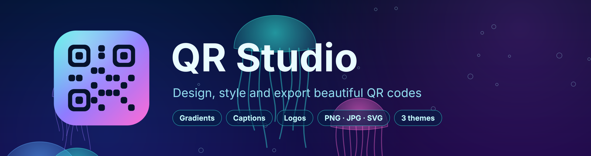
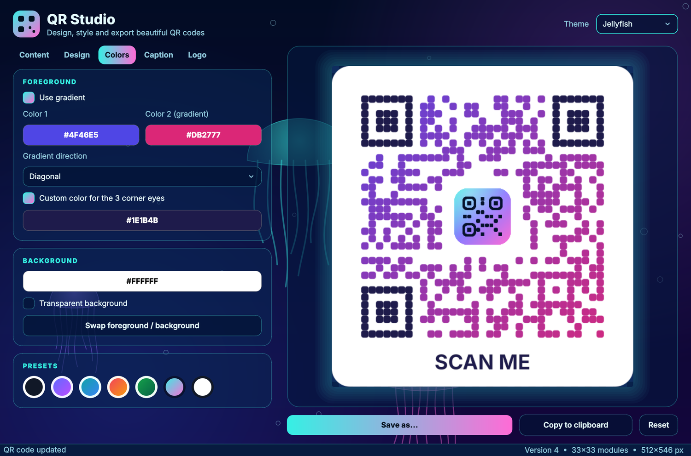
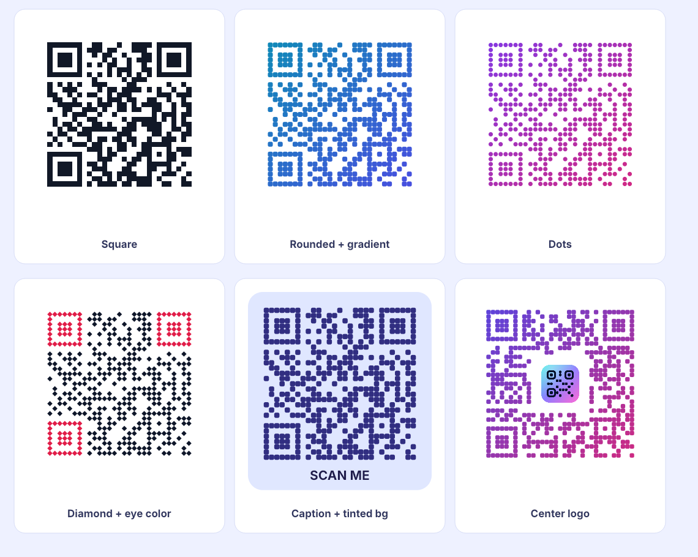
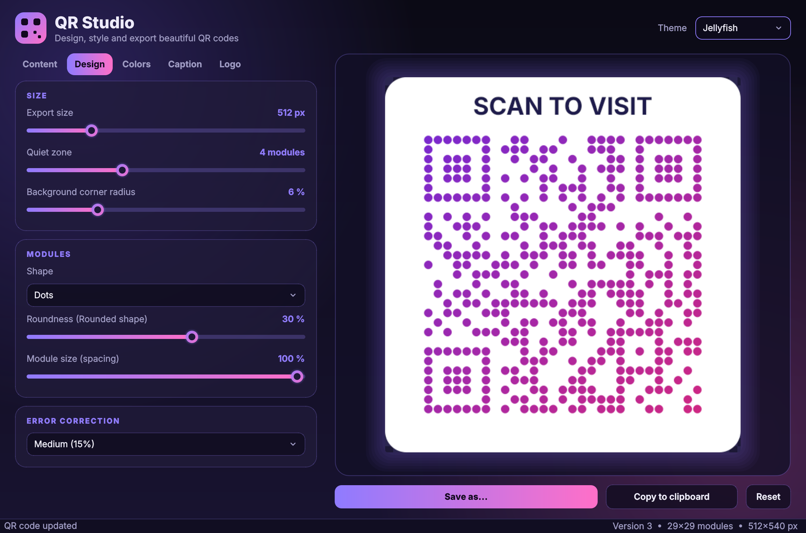
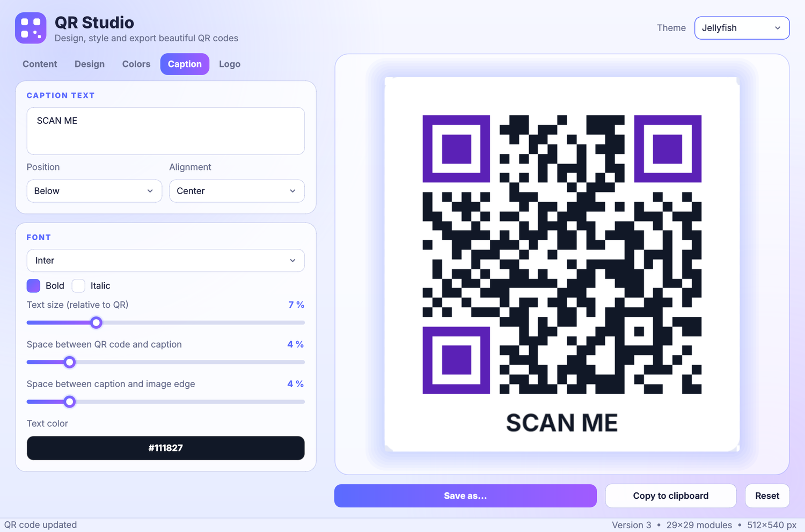
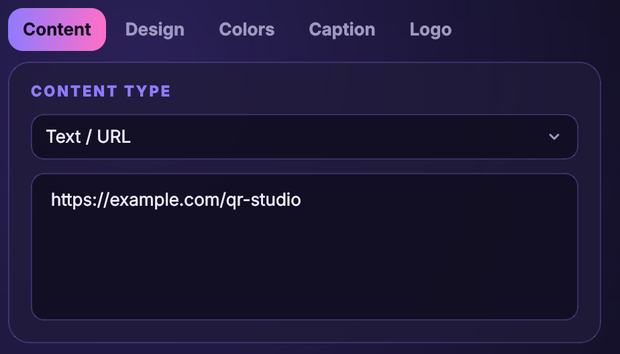
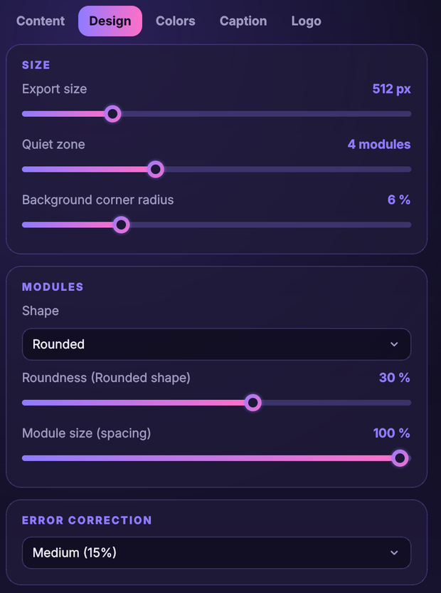
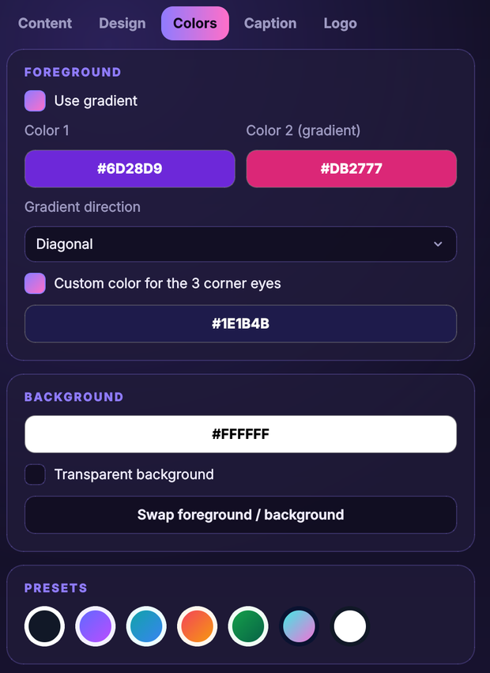
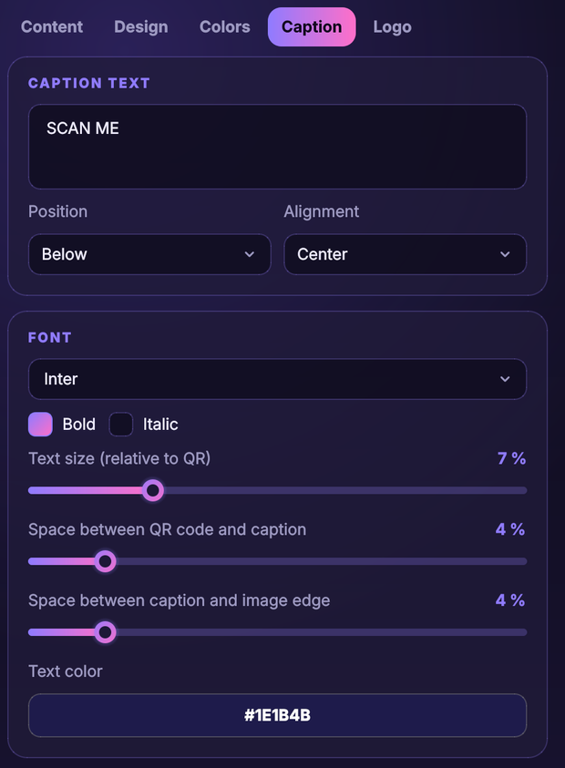
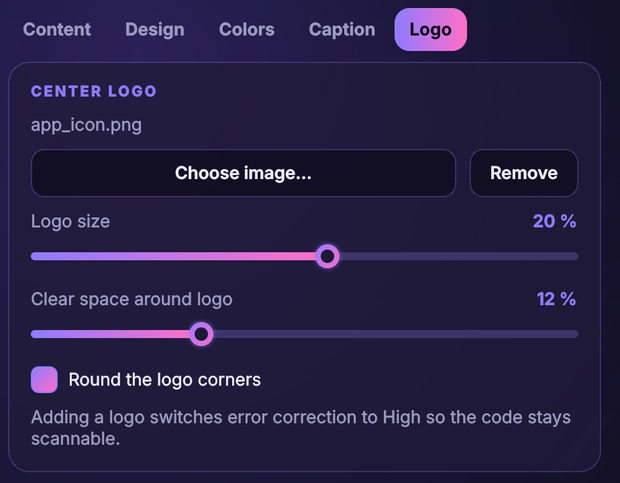

<p align="center">
  
</p>

<p align="center">
  
  
  
  
</p>

<p align="center">
  <b>A modern desktop QR code generator with full control over size, colors, shapes, gradients, captions and logos.</b><br>
  Three themes, live preview, one-click export, and your settings remembered between sessions.
</p>

<p align="center">
  
</p>

---

## Table of contents

- [Features](#features)
- [Style gallery](#style-gallery)
- [Themes](#themes)
- [Installation](#installation)
- [Usage](#usage)
- [Exporting](#exporting)
- [Saved settings and Reset](#saved-settings-and-reset)
- [Tips for reliable scanning](#tips-for-reliable-scanning)
- [Building a Windows executable](#building-a-windows-executable)
- [Project structure](#project-structure)
- [How it works](#how-it-works)
- [Troubleshooting](#troubleshooting)

---

## Features

### Content types
- **Text / URL**
- **Wi-Fi**: network name, password and security (WPA, WEP or open)
- **Email**: address, subject and message
- **Phone number**

### Design
- Export size from **100 to 2000 px**
- Adjustable **quiet zone** (white border), 0 to 12 modules
- Module shapes: **Square, Rounded, Dots, Diamond**
- Roundness and module spacing sliders
- Background **corner radius**
- Error correction: Low (7%), Medium (15%), Quartile (25%), High (30%)

### Colors
- **Solid or gradient** foreground (diagonal, horizontal or vertical)
- Separate color for the three corner **eyes**
- Custom background or **transparent background**
- One-click swap of foreground and background
- Ready-made color **presets**

### Caption
- Add text **above or below** the QR code (multi-line supported)
- Any installed **font**, size, bold / italic, alignment and color
- Adjustable space between the code and the caption, and between the caption and the image edge

### Logo
- Place your own image in the **center** of the code
- Adjustable logo size, clear space and rounded corners
- Error correction switches to **High** automatically while a logo is used

### App
- **Live preview** that updates as you type
- **Status bar** with messages, contrast warnings, and the QR version, module count and image size
- **Light, Midnight and Jellyfish** themes
- All settings **saved and restored** on the next start
- **Reset** button to return to the default design options

---

## Style gallery

Every example below was generated with QR Studio.

<p align="center">
  
</p>

---

## Themes

Pick a theme from the dropdown in the top-right corner. **Jellyfish** (shown at the top of this page) has an animated deep-ocean background with drifting jellyfish and bubbles.

<table>
  <tr>
    <td align="center" width="50%">
      <br>
      <sub><b>Midnight</b>: deep indigo with violet and pink accents</sub>
    </td>
    <td align="center" width="50%">
      <br>
      <sub><b>Light</b>: soft white with indigo accents</sub>
    </td>
  </tr>
</table>

---

## Installation

**Requirements**
- Python **3.10 or newer**
- [PySide6](https://pypi.org/project/PySide6/)
- [qrcode](https://pypi.org/project/qrcode/)

```bash
pip install PySide6 qrcode
```

**Run the app**

```bash
python qr_generator_v2.py
```

> Keep `app_icon.png` and `app_icon.ico` in the same folder as the script so the window icon loads.

---

## Usage

The settings are grouped into five tabs on the left. The live preview and the **Save as...**, **Copy to clipboard** and **Reset** buttons are on the right.

<table>
  <tr>
    <td align="center" width="33%">
      <br>
      <sub><b>Content</b><br>Choose the content type and enter your data</sub>
    </td>
    <td align="center" width="33%">
      <br>
      <sub><b>Design</b><br>Size, quiet zone, module shape, error correction</sub>
    </td>
    <td align="center" width="33%">
      <br>
      <sub><b>Colors</b><br>Gradient, eye color, background, presets</sub>
    </td>
  </tr>
  <tr>
    <td align="center" width="33%">
      <br>
      <sub><b>Caption</b><br>Text above or below, font, alignment, spacing</sub>
    </td>
    <td align="center" width="33%">
      <br>
      <sub><b>Logo</b><br>Center image with size and clear space</sub>
    </td>
    <td width="33%"></td>
  </tr>
</table>

---

## Exporting

Click **Save as...** and choose a format:

| Format | Notes |
|---|---|
| **PNG** | Supports transparency. |
| **JPG** | No transparency, so the background color is used. |
| **SVG** | Scalable vector output. Caption text is stored as live text, so the font must be installed on the machine that opens the file. A logo is embedded as an image. |

**Copy to clipboard** copies the full-size image so you can paste it straight into other apps.

---

## Saved settings and Reset

Your options are saved automatically and restored the next time you open the app. This includes design options, colors, caption settings, the logo, the content you typed, the theme, and the window size and position.

- The **Wi-Fi password is never saved**, so you need to re-enter it each session.
- Settings are stored per user: in the registry on Windows (`HKEY_CURRENT_USER\Software\QRStudio`), in `~/.config/QRStudio` on Linux, and in a `.plist` file in `~/Library/Preferences` on macOS.
- **Reset** restores all design options (size, colors, shapes, caption settings, logo) to their defaults. It keeps the content you typed and your chosen theme.

---

## Tips for reliable scanning

- Keep strong **contrast** between the code and the background. QR Studio shows a warning in the status bar when contrast is low.
- Dark code on a light background is the most widely supported. Light-on-dark (inverted) codes are not read by every scanner.
- Keep a **quiet zone** of at least 2 to 4 modules around the code.
- When using a **logo**, keep it small (around 20% or less) and test the result with a phone before printing.
- Very low **module spacing** values or very light gradient colors can make codes harder to read. Always test before printing or publishing.
- Longer content creates denser codes. Use a larger export size, or a lower error correction level, for very long text.

---

## Building a Windows executable

```bash
pip install pyinstaller
pyinstaller --noconsole --onefile --name "QR Studio" --icon app_icon.ico --add-data "app_icon.png;." qr_generator_v2.py
```

The finished `QR Studio.exe` appears in the `dist` folder. On macOS or Linux, use `:` instead of `;` in the `--add-data` argument.

If Windows Explorer still shows the old icon after rebuilding, it is the icon cache. Rename the exe or restart Explorer.

---

## Project structure

```
.
├── qr_generator_v2.py     # the application
├── app_icon.ico           # multi-size Windows icon (16 to 256 px)
├── app_icon.png           # 512 px icon for the window and taskbar
├── README.md
└── assets/                # images used in this README
    ├── banner.png
    ├── qr-styles.png
    ├── screenshot-jellyfish.png
    ├── screenshot-midnight.png
    ├── screenshot-light.png
    └── tab-*.png
```

---

## How it works

QR Studio uses the [`qrcode`](https://pypi.org/project/qrcode/) library only to compute the QR data matrix. Every module is then drawn by hand with `QPainter`. This is what makes the custom shapes, gradients, eye colors, logo cut-out, captions and true vector SVG export possible. The same drawing code produces the live preview, PNG and JPG files, the clipboard image and the SVG.

---

## Troubleshooting

**"Could not generate QR code" in the status bar**
The content is too long for a QR code at the selected error correction level. Shorten the content or choose a lower error correction level.

**The caption font looks different from what I chose**
The font list shows fonts installed on your system. If you open an exported SVG on another machine, it needs the same font installed.

**The logo does not appear after restarting**
The app remembers the logo's file path. If the image file was moved or deleted, the app starts without a logo. Choose it again on the **Logo** tab.

**The window or sliders look too large or small**
QR Studio follows your system display scaling. Adjust your operating system's scaling setting if needed.
